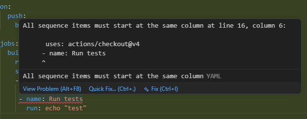
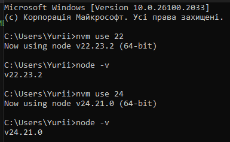
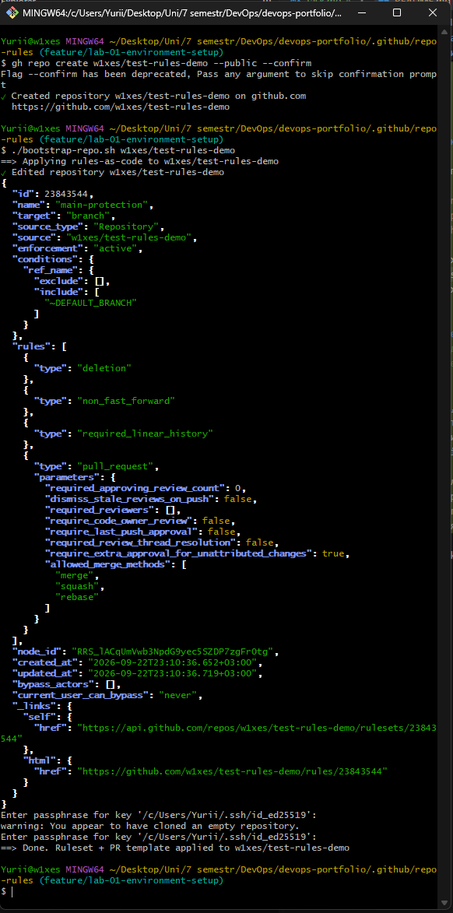

# Лабораторна робота 1 — Середовище та професійний Git workflow

## Завдання 1. Git і редактор

### Глобальні параметри Git

```
$ git config --list --global
core.editor="D:\Microsoft VS Code\bin\code" --wait
core.autocrlf=true
user.name=w1xes
user.email=xpopay98@gmail.com
init.defaultbranch=main
pull.rebase=true
```

**Чому `core.autocrlf` різний для Windows і Unix:**
Windows традиційно використовує `CRLF` як символ кінця рядка, тоді як Unix/Linux/macOS — `LF`. Git-параметр `core.autocrlf` вирішує, чи перетворювати кінці рядків при checkout/commit:
- `true` (типово для Windows) — при checkout Git перетворює `LF → CRLF`, а при commit назад `CRLF → LF`, щоб у репозиторії завжди зберігався уніфікований `LF`.
- `input` (типово для Unix) — Git перетворює `CRLF → LF` тільки при commit, при checkout нічого не змінює.

Якщо в команді зі змішаними ОС цей параметр не задати (або задати неоднаково), у diff з'являтимуться "фантомні" зміни цілих файлів (весь файл виглядає зміненим, хоча змінився лише 1 рядок) через різницю кінців рядків — це засмічує історію та ускладнює code review і merge (конфлікти на рівні кожного рядка).

**Чим `pull.rebase=true` відрізняється від типового `pull`:**
Типовий `git pull` = `fetch` + `merge`, що створює зайвий merge-коміт щоразу, коли локальна гілка розійшлася з віддаленою. З `pull.rebase=true` замість merge виконується `rebase`: локальні коміти "переносяться" поверх нових коммітів з віддаленої гілки. Результат — лінійна історія без зайвих merge-комітів, `git log` читається як послідовна стрічка подій, а не мережа злиттів.

### Редактор (VS Code)

Встановлені розширення:
- **GitLens** — історія змін і авторство рядків (blame) просто в редакторі
- **Docker** (ms-azuretools.vscode-docker) — підсвічування й лінтинг Dockerfile/Compose
- **YAML** (redhat.vscode-yaml) — підсвічування YAML зі схемами (у т.ч. для GitHub Actions)
- **Markdown Preview / Markdown All in One** — перегляд Markdown



### `.editorconfig`

Файл `.editorconfig` у корені репозиторію задає:
- відступи (2 пробіли за замовчуванням, 4 для Python)
- кінець рядка `LF`
- обов'язковий фінальний перенос рядка
- обрізання кінцевих пробілів

Для роботи `.editorconfig` у VS Code встановлено розширення **EditorConfig for VS Code**, а `editor.formatOnSave` увімкнено в налаштуваннях.

---

## Завдання 2. Середовища виконання

| Інструмент | Версія | Спосіб встановлення |
|---|---|---|
| Node.js | 24.21.0 / 22.23.2  | nvm (менеджер версій) |
| Python | 3.13.7 |  Python Install Manager |
| Docker | 29.8.0 | Docker Desktop |
| Docker Compose | 5.5.1 | вбудований у Docker Desktop (Compose v2) |

**Перемикання версій Node.js:**



**Навіщо менеджер версій, коли проєктів більше одного:**
Різні проєкти часто вимагають різних (несумісних) версій Node.js/Python. Без менеджера версій довелося б тримати одну системну версію на всю машину і вручну перевстановлювати її під кожен проєкт, ризикуючи зламати інші проєкти. Менеджер версій (nvm, fnm, pyenv, uv) дозволяє:
- тримати декілька версій паралельно
- перемикатися між ними за секунди (`nvm use`, `pyenv local`)
- фіксувати потрібну версію в файлі проєкту (`.nvmrc`, `.python-version`), щоб вона автоматично підхоплювалась при вході в директорію

---

## Завдання 3. GitHub і доступ

- Профіль GitHub заповнено: ім'я, фото, короткий опис.
- Двофакторна автентифікація увімкнена.
- Створено SSH-ключ типу `ed25519` з парольною фразою, публічний ключ додано в акаунт GitHub.

**Перевірка з'єднання:**

Порт 22 (стандартний SSH) виявився заблокованим мережею:
```
$ ssh -T git@github.com
ssh: connect to host github.com port 22: Connection timed out
```

Це поширена ситуація — деякі провайдери/мережі блокують вихідний трафік на порт 22. GitHub передбачає обхід: тунелювання SSH-трафіку через порт 443 (стандартний HTTPS), який майже завжди відкритий, використовуючи хост `ssh.github.com`.

Налаштовано `~/.ssh/config`:
```
Host github.com
  Hostname ssh.github.com
  Port 443
  User git
  IdentityFile ~/.ssh/id_ed25519
```

Після цього звичайна команда `ssh -T git@github.com` автоматично йде через порт 443:
```
$ ssh -T git@github.com
Hi w1xes! You've successfully authenticated, but GitHub does not provide shell access.
```

**Чому приватний ключ ніколи не потрапляє в репозиторій:**
Приватний ключ — це єдиний секрет, що підтверджує особу власника; будь-хто, хто його отримає, може автентифікуватись від твого імені без пароля (лише passphrase, якщо вона є). Публічний репозиторій (а тим паче й приватний) не є безпечним сховищем секретів: історія Git зберігає всі версії файлу назавжди, доступ можуть мати інші учасники, форки, CI-логи тощо.

**Якщо приватний ключ усе ж потрапив у репозиторій, послідовність дій:**
1. Негайно вважати ключ скомпрометованим — не покладатися на просте видалення файлу.
2. Видалити публічний ключ з GitHub (Settings → SSH and GPG keys) — це миттєво унеможливлює автентифікацію ним.
3. Згенерувати новий ключ (`ssh-keygen`), додати новий публічний ключ в акаунт.
4. Прибрати старий ключ з історії Git (`git filter-repo` або BFG Repo-Cleaner), а не просто новим комітом — інакше він і далі буде в історії.
5. Форснути оновлену історію (`git push --force`) у всіх клонах/форках, якщо це можливо, і попередити співавторів перестворити свої локальні копії.
6. Перевірити логи доступу GitHub (Security log) на предмет підозрілої активності за час, поки ключ був публічним.

---

## Завдання 4. Портфоліо-репозиторій

- `.gitignore` згенеровано вручну під стек Node.js/Python/Docker (секції Node, Python, Docker, OS, IDE, Secrets).
- Ліцензія: **MIT** — обрана, бо це навчальний портфоліо-проєкт, і мета — максимальна відкритість і можливість вільного використання/копіювання коду роботодавцями чи іншими студентами без юридичних обмежень.
- Структура тек `lab-01` … `lab-10`, `final/` створена заздалегідь.

---

## Завдання 5. Правила репозиторію

Налаштовано ruleset для гілки `main`:
- обов'язковий pull request перед злиттям (required approvals: 0 — соло-репозиторій)
- заборона force-push
- заборона видалення гілки
- лінійна історія

**Що поки не увімкнено і чому:**
- **Обов'язкові перевірки статусу** — недоступні, поки жоден workflow жодного разу не запускався (з'явиться після Лаб. 4, коли буде CI).
- **Обов'язкова рецензія / заборона обходу правил адміністратором** — у соло-репозиторії автор PR не може сам себе схвалити, тож це заблокувало б будь-яке злиття. Стане доречним у Лаб. 2, коли з'явиться команда.

**Що зміниться, коли робота стане командною:**
Потрібно буде увімкнути обов'язкову рецензію (мінімум 1 approval від іншого учасника) та заборону обходу правил для адміністраторів. Соло "заборона обходу правил адміністратором" шкідлива, бо адміністратор (я) — єдина людина, яка може щось змінити, і жорстке самоблокування лише заважає роботі. У команді ж це навпаки безпечно й потрібно: без цього правила будь-який адміністратор міг би обійти рев'ю і запушити що завгодно напряму, що знецінює сенс захисту гілки.

Дошка проєкту (Project) з колонками Backlog / In Progress / Review / Done та автоматизаціями (нова задача → Backlog, відкритий PR → Review, злитий PR → Done, закрита задача → Done) — створена.

Шаблон pull request — `.github/pull_request_template.md`.

---

## Бонус. Правила як код

Усі налаштування репозиторію з завдання 5 (ruleset для `main` + PR-шаблон) продубльовано як конфігурацію в `.github/repo-rules/`:

- `main-ruleset.json` — те саме правило захисту гілки, що і в UI, описане в форматі GitHub Rulesets API
- `pull_request_template.md` — копія шаблону PR
- `bootstrap-repo.sh` — скрипт на `gh api` / `gh repo`, що застосовує обидва файли до **нового порожнього репозиторію** однією командою:
  ```bash
  gh repo create w1xes/test-rules-demo --public --confirm
  ./bootstrap-repo.sh w1xes/test-rules-demo
  gh repo delete w1xes/test-rules-demo --yes
  ```

**Демонстрація на тестовому репозиторії:**



**Чому налаштування, зроблені кліками, — проблема для команди:**
Кожен клік у веб-інтерфейсі — це дія, яку ніхто не бачить у git-історії: незрозуміло, хто, коли й навіщо ввімкнув чи вимкнув конкретне правило. Відтворити те саме налаштування на другому репозиторії можна лише "по пам'яті" або зі скріншотів у документації, а це майже гарантовано призводить до розбіжностей між репозиторіями команди. Ревізувати (code review) клік у браузері неможливо — на відміну від diff у pull request.

**Що змінюється, коли налаштування описані кодом:**
- Правила стають версійованим артефактом: зміну ruleset можна побачити в `git log`, обговорити в pull request, відкотити при потребі.
- Налаштування одного разу — і застосовується однаково до будь-якої кількості репозиторіїв одним скриптом, без ручного повторення кроків.
- Це та сама ідея, яку курс покаже ще двічі — у CI-пайплайні (конфігурація збірки як код) і в описі інфраструктури (Terraform/Ansible замість ручного налаштування серверів).
